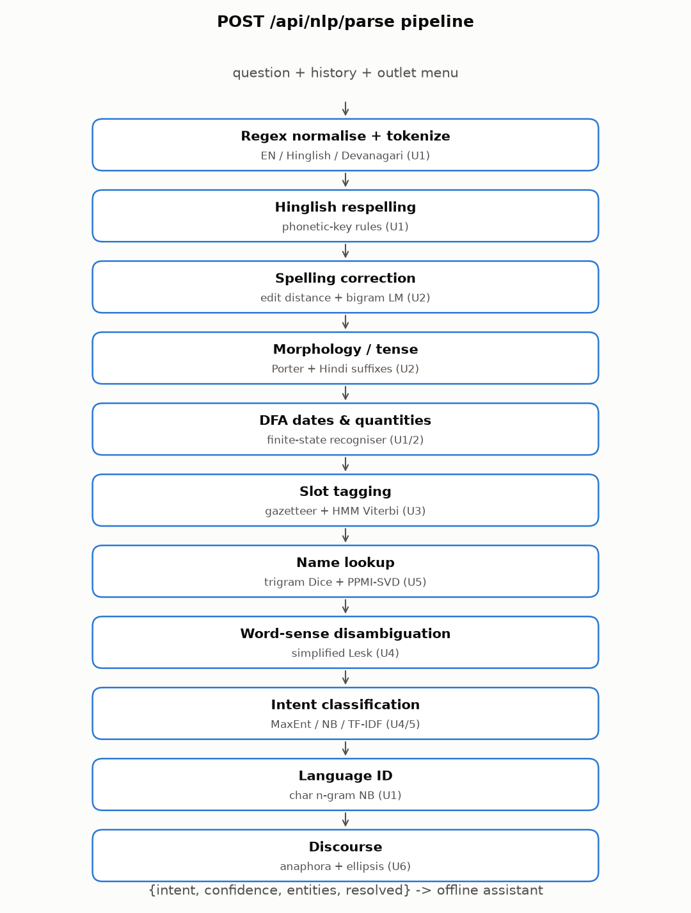
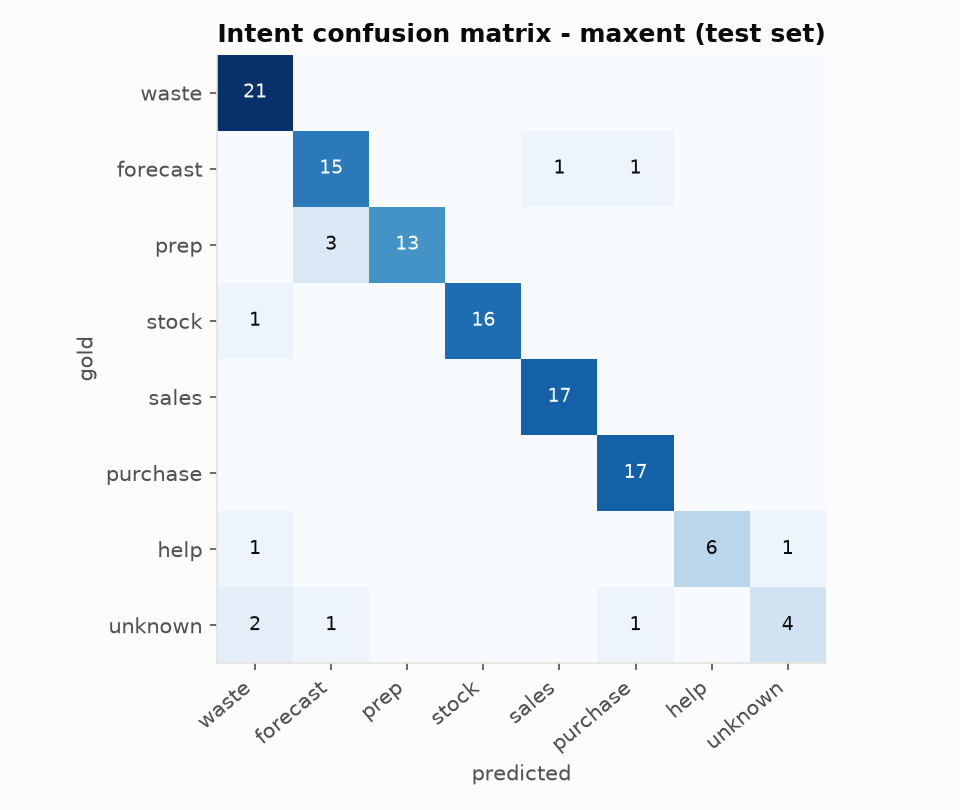
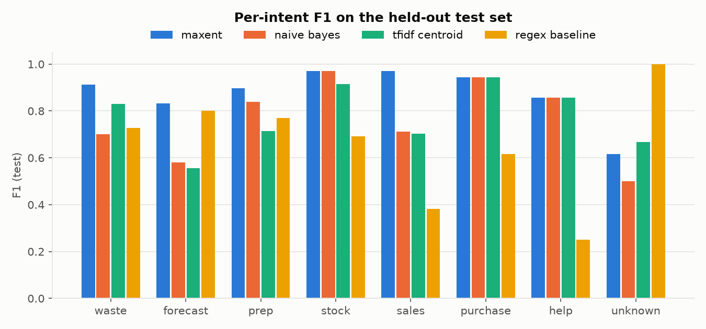
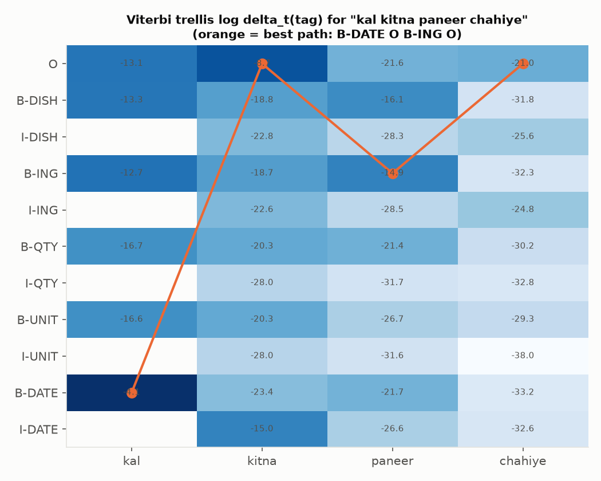
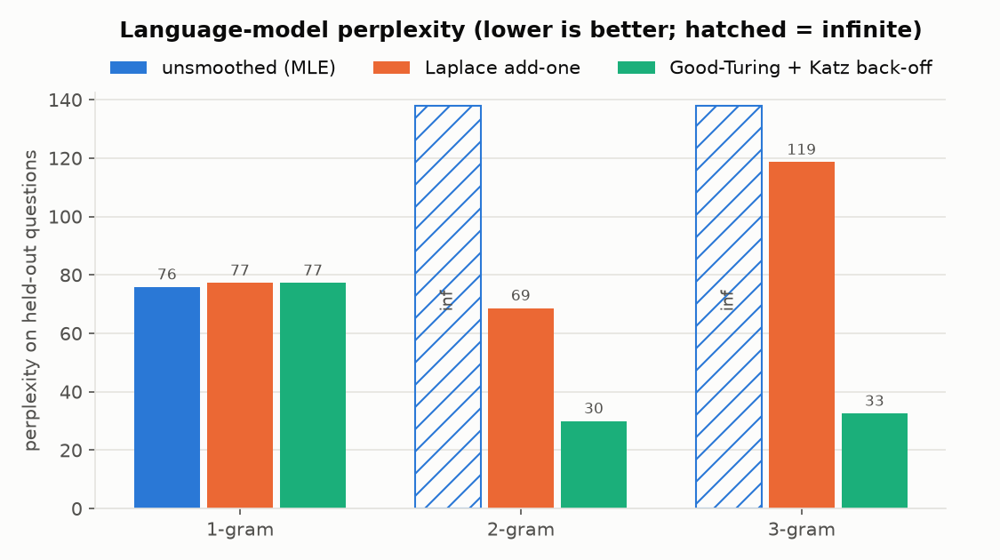
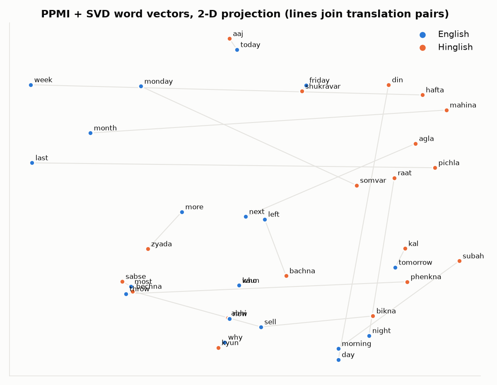
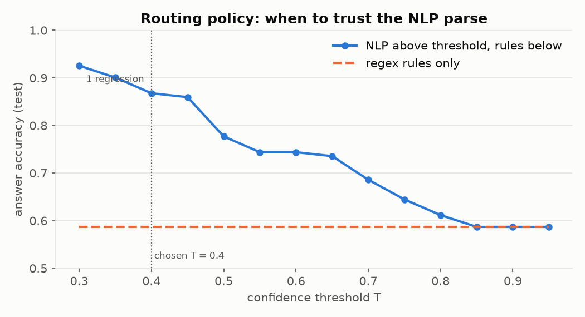

# Zero Plate NLP pipeline - evaluation results

Generated by `cd backend && python -m app.nlp.report`. Every algorithm below is implemented from scratch
in `backend/app/nlp/` (numpy only); scikit-learn appears solely as a comparison baseline.

Versions: Python 3.13.7, numpy 2.5.4, scikit-learn 1.9.1, FastAPI 0.143.0, matplotlib 3.11.2.



## Dataset

`backend/app/nlp/data/intents.jsonl`, built by `python -m app.nlp.data.generate` (seed 13): 482 questions, 361 train / 121 test.

| split | English | Hinglish | templated | hand-written |
|---|---|---|---|---|
| train | 197 | 164 | 251 | 110 |
| test | 69 | 52 | 75 | 46 |

Templated questions are split **by template** (a test sentence never shares its frame with a training
sentence) and hand-written ones 70/30 stratified by intent. Intents: waste, forecast, prep, stock, sales, purchase, help, unknown.
Per intent (train/test): waste 66/21, forecast 53/17, prep 49/16, stock 50/17, sales 54/17, purchase 51/17, help 19/8, unknown 19/8.

## Intent classification (Units 4-5)

The runtime classifier is chosen by accuracy on a 20% dev split of *train* (no test peeking): **maxent** (dev accuracies: naive_bayes 0.863, maxent 0.931, tfidf_centroid 0.836, tfidf_knn 0.808, ppmi_centroid 0.548, ensemble 0.877).

| classifier | test accuracy | macro-F1 | English | Hinglish |
|---|---|---|---|---|
| naive bayes | 77.7% | 0.763 | 76.8% | 78.8% |
| maxent | 90.1% | 0.875 | 87.0% | 94.2% |
| tfidf centroid | 77.7% | 0.773 | 78.3% | 76.9% |
| tfidf knn | 60.3% | 0.601 | 59.4% | 61.5% |
| ppmi centroid | 57.9% | 0.590 | 56.5% | 59.6% |
| ensemble | 82.6% | 0.810 | 85.5% | 78.8% |
| regex baseline | 58.7% | 0.654 | 82.6% | 26.9% |
| sklearn logreg baseline | 91.7% | 0.900 | 88.4% | 96.2% |

The regex baseline is the original rule cascade of `offline.ts` (ported to Python); its single help reply is
counted as correct for both `help` and `unknown`. The scikit-learn logistic regression uses exactly the same
features as the from-scratch MaxEnt and is shown only for comparison.





Confusion matrix (rows gold, columns predicted; order waste, forecast, prep, stock, sales, purchase, help, unknown):

```
 21   0   0   0   0   0   0   0
  0  15   0   0   1   1   0   0
  0   3  13   0   0   0   0   0
  1   0   0  16   0   0   0   0
  0   0   0   0  17   0   0   0
  0   0   0   0   0  17   0   0
  1   0   0   0   0   0   6   1
  2   1   0   0   0   1   0   4
```

Misclassified test questions (12): "what do we need to prepare next week" (prep->forecast); "what do we need to prepare day after tomorrow" (prep->forecast); "what do we need to prepare next monday" (prep->forecast); "how many orders should we expect tonight" (forecast->purchase); "aaj raat kitne order aayenge" (forecast->sales); "show inventory levels" (stock->waste); "namaste" (help->waste); "how do i use this" (help->unknown); "tell me a joke" (unknown->waste); "set an alarm for 6" (unknown->purchase); "koi movie batao" (unknown->forecast); "write me a poem about love" (unknown->waste)

## Slot tagging (Unit 3)

HMM with BIO tags (11 states), supervised MLE + add-k smoothing, open-class symbols for unknown words,
Viterbi decoding with BIO constraints. `unseen names` replaces every dish/ingredient in the test sentences
with a name absent from the gazetteer (e.g. *hakka noodles*, *capsicum*).

| tagger | test token acc. | test entity F1 | unseen-names token acc. | unseen-names entity F1 | unseen DISH F1 | unseen ING F1 |
|---|---|---|---|---|---|---|
| rule baseline | 99.6% | 0.993 | 82.5% | 0.631 | 0.000 | 0.000 |
| hmm viterbi | 97.9% | 0.924 | 83.1% | 0.617 | 0.210 | 0.111 |
| hybrid pipeline | 99.5% | 0.989 | 84.4% | 0.672 | 0.210 | 0.121 |

On names the gazetteer knows, longest-match rules are near perfect and the HMM alone is weaker; the HMM's
value is context (it finds some names no list contains). The pipeline therefore uses the hybrid: DFA for
dates/quantities, gazetteer for known names, HMM spans only over genuinely unknown words.
Date/quantity DFA alone on gold DATE/QTY spans: P 0.988, R 0.988, F1 0.988.



## Language model (Unit 2)

Word n-grams over the training questions (words seen once -> `<UNK>`), perplexity on the test questions.

| model | vocab | unsmoothed | Laplace | Good-Turing (Katz) | zero-probability test tokens (MLE) |
|---|---|---|---|---|---|
| 1-gram | 245 | 75.8 | 77.2 | 77.2 | 0/889 |
| 2-gram | 245 | inf | 68.6 | 29.9 | 233/889 |
| 3-gram | 245 | inf | 118.6 | 32.5 | 489/889 |



Laplace moves too much mass to unseen n-grams (the trigram is *worse* than the bigram); Good-Turing
discounting with Katz back-off is best, with the bigram slightly ahead of the trigram on this small corpus.

## Spelling correction (Unit 2)

Noisy channel: weighted Damerau-Levenshtein candidates x bigram Katz LM prior. Accuracy **86.1%** on 36 cases (misspellings fixed 27/32, brand/new words left alone 4/4); false-correction rate on clean test questions 0.5% of tokens. lambda = 3.0.

Failures: wastege->waste (want wastage); aproved->approve (want approved); seler->sell (want seller); chikpeas->chikpeas (want chickpeas); wastge->waste (want wastage).

lambda sensitivity (same set, so indicative only): lambda=1.0: 80.6%, lambda=2.0: 80.6%, lambda=3.0: 86.1%, lambda=4.0: 77.8%, lambda=5.0: 72.2%.

## Word-sense disambiguation (Unit 4)

Simplified Lesk over a hand-written gloss dictionary: **90.2%** on 41 labelled sentences vs 43.9% for the most-frequent-sense baseline. Per word: plate 8/10, order 10/10, stock 8/8, kal 6/8, left 5/5.

## Embeddings and cross-lingual mapping (Unit 5)

PPMI (window 2, context smoothing 0.75) + truncated SVD to 48 dimensions over 377 words, code-switching augmentation with half of the bilingual dictionary.

| translation pairs | P@1 | P@5 | pairs in vocab |
|---|---|---|---|
| seed (used for augmentation) | 0.93 | 0.96 | 45 |
| held out | 0.00 | 0.09 | 35 |

Similarities: chai~tea 0.986, sabzi~vegetable 1.0, chai~onion 0.428. Nearest neighbours: chai: tea, curd, sugar; sabzi: vegetable, anda, check; paneer: curd, sugar, watch; kal: tomorrow, plan, footfall; bikna: sell, veg, gulab; waste: cost, kharcha, itni.

Honest reading: the augmentation aligns the pairs it was given (chai~tea, sabzi~vegetable), but a few
hundred questions are far too little for held-out translations to emerge distributionally, so the
bilingual dictionary remains the main cross-lingual mechanism and the vectors are a synonym back-off.



## Language ID (Unit 1)

Character 1-3-gram Naive Bayes per word, sentence label by Hindi share: English-vs-Hinglish sentence accuracy **95.0%** on the test set (en->en 63, en->mixed 6, hi-Latn->hi-Latn 32, hi-Latn->mixed 20).

## Discourse: anaphora and ellipsis (Unit 6)

25 hand-written two/three-turn dialogues (`data/coref.json`): **100.0%** resolved fully (intent + referent); the same follow-ups without history: 24.0%. The dialogues were written alongside the module, so this is a functional check rather than an unbiased estimate.

## Routing policy and safety (offline assistant)

`offline.ts` uses the parse only when `confidence >= T`, the intent has a data answer (not help/unknown)
and a purchase question names an ingredient; otherwise the original regex rules answer. T is the smallest
grid value with **zero regressions** on the test set (0.35) plus one
0.05 step of margin: **T = 0.4**.

| set | answer accuracy, rules only | answer accuracy, combined | regressions |
|---|---|---|---|
| test | 58.7% | 86.8% | 0 |
| train + test | 56.4% | 96.5% | 0 |

A *regression* is a question the rules answer with the right intent that the combined path answers with a
different one. The same check runs in vitest (`offline.test.ts`) against the real TypeScript rules using the
recorded parses in `frontend/src/lib/assistant/__fixtures__/nlp-regression.json`.



Failure handling on the Next.js side: 1.5 s AbortController timeout; any network error, non-200 or
malformed JSON -> rules, silently; after a failure the parser is skipped for 30 s while a non-awaited
warm-up request wakes the (free-tier, sleeping) service. The Claude path (ANTHROPIC_API_KEY set) is unchanged,
and `/api/assistant` / `/api/mobile/assistant` keep their response shapes.

## Latency and footprint

In-process FastAPI TestClient, 363 requests (test questions with one history turn): **p50 6.71 ms, p95 36.16 ms**, max 64.79 ms. First request including lazy model training: 1783.0 ms. Training happens once per process; models occupy about 2.6 MB of numpy arrays; peak Python allocation while training (tracemalloc) 13.6 MB.

## Sample transcript

Parsed with `today = 2026-10-25`; *tool* is the data call `offline.ts` makes (answers then come from the
outlet's own data, so no numbers are shown here).

| # | question (history) | lang | intent (conf.) | slots / fixes | tool call |
|---|---|---|---|---|---|
| 1 | Which dish did we waste most last month? | en | waste (0.76) | date=last month | `wasteSummary(days=30)` |
| 2 | kal kitna paneer chahiye | hi-Latn | purchase (0.70) | ingredient=Paneer, date=kal | `orderSuggestion("Paneer", days=1)` |
| 3 | aaj kitna waste hua | mixed | waste (0.87) | date=aaj | `wasteSummary(days=1)` |
| 4 | forcast for tomorrow | en | forecast (0.81) | date=tomorrow; fixed forcast->forecast | `forecastFor(start=2026-10-26, days=1)` |
| 5 | how much panner should I order for next friday? | en | purchase (0.91) | ingredient=Paneer, date=next friday; fixed panner->paneer | `orderSuggestion("Paneer", days=5)` |
| 6 | and milk? *(after: how much paneer do we have)* | en | stock (0.78) | ingredient=Milk; ellipsis | `stockLevels("Milk")` |
| 7 | how much of it should i order for the weekend *(after: how much paneer do we have)* | en | purchase (0.69) | ingredient=Paneer, date=weekend; it -> Paneer | `orderSuggestion("Paneer", days=7)` |
| 8 | कल कितनी बिरयानी बिकेगी | hi-Latn | forecast (0.63) | dish=Chicken Biryani, date=kal; fixed बिरयानी->biryani | `forecastFor(start=2026-10-26, days=1, dish="Chicken Biryani")` |
| 9 | pichle hafte ki sales kitni thi | hi-Latn | sales (0.77) | date=pichle hafte | `salesSummary(days=7)` |
| 10 | aur parso? *(after: kal kitni biryani bikegi)* | hi-Latn | forecast (0.63) | dish=Chicken Biryani, date=parso; ellipsis | `forecastFor(start=2026-10-27, days=1, dish="Chicken Biryani")` |
| 11 | tell me a joke | mixed | waste (0.24) |  | `keyword rules (NLP not used)` |

## Tests

- NLP tests (`backend/tests/test_nlp_*.py`): 26 passed, 1 warning in 11.34s
- Whole backend suite: 67 passed, 1 warning in 27.53s
- Frontend: `npm run typecheck` and `npm test` (includes `src/lib/assistant/offline.test.ts`).

## Syllabus map

| unit | topic | module |
|---|---|---|
| 1 | tokenisation (EN, Hinglish, Devanagari transliteration) | `tokenizer.py` |
| 1 | regex normalisation, Hinglish spelling variants | `normalize.py` |
| 1 | language identification (char n-grams) | `langid.py` |
| 1/2 | finite-state automaton for dates / quantities | `fsa.py` |
| 2 | morphology: Porter stemmer, -age derivation, Hindi inflection, tense | `morphology.py` |
| 2 | n-gram LM, Laplace, Good-Turing + Katz back-off, perplexity | `lm.py` |
| 2 | spelling correction, weighted edit distance, noisy channel | `spell.py` |
| 3 | HMM slot tagging, Viterbi, rule baseline | `hmm.py`, `gazetteer.py` |
| 3/4 | MaxEnt (multinomial logistic regression) | `classifiers.py` |
| 4 | Naive Bayes intent classifier | `classifiers.py` |
| 4 | WSD, simplified Lesk | `wsd.py` |
| 5 | TF-IDF, cosine centroid and k-NN | `classifiers.py` |
| 5 | PPMI + SVD vectors, cross-lingual mapping, fuzzy lookup | `embeddings.py`, `gazetteer.py`, `features.py` |
| 6 | anaphora (Hobbs/centering-inspired), ellipsis | `coref.py` |

Not implemented: CRF, CYK parsing (optional in the brief).
